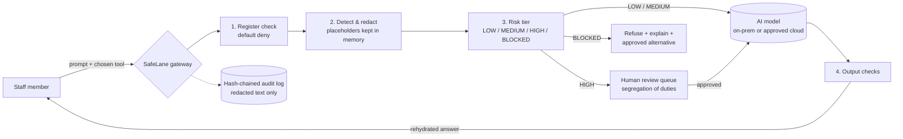

# SafeLane AI Gateway

**Make the safe way to use AI the easiest way.**

**▶ Live demo:** [sibusiso90.github.io/safelane](https://sibusiso90.github.io/safelane/). No install needed: it runs entirely in your browser, so nothing you type is sent anywhere.  
**🎬 Demo video:** [docs/SafeLane_Demo.mp4](docs/SafeLane_Demo.mp4) is a 5½-minute narrated walkthrough of every feature.

SafeLane sits between staff and AI tools. Each prompt passes through it on the way out, and it does four things:

1. **Checks the AI Tools Register.** Approved, restricted, not approved or prohibited. Anything unlisted is blocked by default, and the user is pointed to an approved alternative.
2. **Redacts sensitive data before it leaves.** Names, SA ID numbers, cards, bank accounts, phone numbers, e-mails, credentials and internal codenames are replaced with placeholders. A *Project …* name that is not on the register is redacted too, and the user is asked to confirm it is public. Numbers hidden with invisible characters (zero-width spaces, soft hyphens), written in fullwidth digits, or spelled out (*"eight zero zero …"*, *"double five"*, Afrikaans *"agt nul"*) are caught as well. The model never sees the real values; the gateway swaps them back into the answer for the user.
3. **Sorts each request by risk.** `LOW` → send. `MEDIUM` → send redacted. `HIGH` (e.g. *"should we hire her?"*) → hold for a human reviewer. `BLOCKED` (secrets, injection attempts, unapproved tools) → refuse and explain.
4. **Logs everything in a tamper-evident audit trail.** Each entry carries a keyed hash (HMAC-SHA256) of the one before it, and the latest entry is signed, so an edited entry, a deleted one (including the newest), and a chain re-hashed by someone without the key are all detected. The log stores the *redacted* prompt, so the audit trail does not become a new leak.

Everyone **signs in**, and their role decides what they can do: **staff** ask, **reviewers** release other people's held requests, **auditors** read and verify the log, and **admins** run the gateway. No role can do everything, and who asked or approved comes from the session, never from a name typed into a form.

It also **checks what comes back**: sensitive data the user never sent, made-up placeholders, unverified links, and *"draft only, a person decides"* labels on high-impact answers.

> Built for the Credify System Thinking Challenge 2026, challenge area 01: *AI & Cybersecurity*.
> All data in this repository is synthetic. The organisation ("Acme Utilities") is fictional.


---

## Why a gateway and not just a policy?

Staff use AI because it saves them time. When the approved route is slower than a personal chatbot account, people take the shortcut, and a ban pushes that use out of sight (shadow AI). SafeLane works with that incentive instead of against it: the governed route is the quick one, and the controls run automatically. The full system analysis (stakeholders, root causes, causal loops, options considered, risks) is in [docs/SafeLane_Project_Documentation.pdf](docs/SafeLane_Project_Documentation.pdf).

## Technologies used

- **Python 3.11+** with **FastAPI** and **Uvicorn** for the gateway API
- **Pydantic** for request validation; **PyYAML** for the AI Tools Register and accounts
- **PBKDF2-HMAC-SHA256** password hashes, bearer-token sessions and role checks (Python standard library)
- **SQLite** (Python standard library) for the audit log, chained with **HMAC-SHA256**
- **Plain HTML/CSS/JavaScript** single-page UI, with no build step
- **httpx2** for calling an optional OpenAI-compatible model endpoint (e.g. a local **Ollama**)
- **pytest** for the automated tests
- **Pyodide** (Python compiled to WebAssembly) and **GitHub Pages / Actions** for the online demo

No cloud services, API keys or external databases are required to run it.

## Architecture



| Path | What it is |
|---|---|
| `safelane/redactor.py` | Detectors (regex + checksums + context rules), placeholder mapping, rehydration |
| `safelane/policy.py` | Register, risk rules R1–R8, output checks |
| `safelane/audit.py` | SQLite audit log chained with HMAC-SHA256, a signed head record, and verification |
| `safelane/accounts.py` | Sign-in, password hashing, sessions, lockout and the four roles |
| `safelane/llm.py` | Mock model (default) or any OpenAI-compatible endpoint, e.g. a local Ollama |
| `safelane/service.py` | Gateway logic (sign-in, ask, review queue, audit) and role checks, independent of any web framework |
| `safelane/main.py` | FastAPI app exposing the gateway over HTTP |
| `static/index.html` | Single-page demo UI (no build step) |
| `static/pyodide-api.js` | In-browser backend for the online demo: runs the same `safelane` package via Pyodide |
| `config/register.yaml` | Example AI Tools Register + sensitive internal terms |
| `config/accounts.yaml` | Demo sign-in accounts, one per role (password hashes only) |
| `eval/` | Synthetic test sets, evaluation script, results |
| `tests/` | 92 automated tests |

### Policy rules (evaluated in order; the first match wins)

| Rule | Trigger | Decision |
|---|---|---|
| R1 | Tool is unlisted, not approved, or prohibited | BLOCKED + suggest approved tool |
| R2 | Prompt-injection / control-evasion pattern | BLOCKED + security flag |
| R3 | Credential or key, going to an off-premises tool | BLOCKED + "rotate it" flag |
| R4 | Decision about a person or money (hire, dismiss, loan, claim…) | HIGH → human review |
| R5 | Declared data class above the tool's approved level | BLOCKED (approved tool) / HIGH (restricted tool) |
| R6 | Sensitive data on a restricted tool | HIGH |
| R7 | Sensitive data on an approved tool | MEDIUM → redact and send |
| R8 | Nothing sensitive | LOW → send |

## Run it

**Online:** https://sibusiso90.github.io/safelane/ is the same code, deployed to GitHub Pages by `.github/workflows/pages.yml`. With no server there, the page loads Python in the browser (Pyodide) and runs the gateway locally. Each visitor gets their own fresh audit log and review queue, which reset on reload.

**Locally:**

Requires Python 3.11+.

```bash
git clone https://github.com/sibusiso90/safelane.git && cd safelane
python -m venv .venv && source .venv/bin/activate      # Windows: .venv\Scripts\activate
pip install -r requirements.txt
SAFELANE_DEMO=1 uvicorn safelane.main:app --reload   # demo accounts + tamper demo
```

Open http://localhost:8000 and sign in with one of the demo accounts. They only exist in demo mode (`SAFELANE_DEMO=1`); a server started without it has no accounts until `SAFELANE_ACCOUNTS` points at a real file, and it refuses a file that carries a published demo password. They all use the password `safelane-demo`, and the sign-in page lists them, so one click signs you in:

| Account | Role | Can |
|---|---|---|
| `thandi` (Thandi Nkosi, Customer Care) | staff | Ask the AI; see her own held requests, and their answers once released |
| `sipho` (Sipho Dlamini, Information Security) | reviewer | Ask; approve or reject other people's held requests |
| `pieter` (Pieter van Wyk, Human Resources) | reviewer | The same, so a reviewer's own held request can be released by someone else |
| `zanele` (Zanele Mokoena, Internal Audit) | auditor | Read and verify the audit log and the review queue; cannot ask or approve |
| `ayesha` (Ayesha Patel, IT Operations) | admin | Read the audit log and queue, and run the tampering demo; cannot ask or approve |

As Thandi, use the sample buttons (Personal info, API key, Hiring decision, Wrapper plugin, Injection…). Sign in as Sipho to release a held request (he sees placeholders only), back in as Thandi to read the answer with her real values restored, and as Zanele to **Verify chain** under **Audit log**. Five failed sign-ins from one client lock that account for that client for 15 minutes, so a stranger guessing cannot lock the owner out, 20 failures from one client across any accounts lock that client, and 50 failures on one account from any mix of clients lock the account. IPv6 clients are counted by /64 network. Every sign-in is logged. Behind a reverse proxy, run uvicorn with `--proxy-headers` so the limits see real client addresses.

The quickest tour is **Guided demo** on the Ask AI page: nine steps, one click each, signing in as each account in turn, from redaction to a reviewer releasing a held request to a caught tampering attempt. **Simulate tampering** (admin only) edits one stored entry without updating its hash, so you can watch verification fail and then restore it. The online demo always shows it (each visitor has their own in-browser log). On a server it needs demo mode too, because it lets an admin edit the log.

**Before real use**, replace `config/accounts.yaml` (or point `SAFELANE_ACCOUNTS` at your own file, or sign people in through your identity provider) set `SAFELANE_AUDIT_KEY` to a secret kept outside the server's disk, and point `SAFELANE_AUDIT_HEAD` at write-once storage. Without them, the key and the signed head are kept in files next to the log. That stops someone who can only edit the database, but not someone who can also write those files: they could restore an older head together with a shortened log.

**Use a real model (optional).** By default a mock model is used, so nothing leaves your machine and no API key is needed. To use a local model:
```bash
export SAFELANE_LLM_URL=http://localhost:11434/v1     # Ollama's OpenAI-compatible API
export SAFELANE_LLM_MODEL=qwen3:4b-instruct
```

**Tests and evaluation**
```bash
pytest -q                                      # 92 tests
python eval/run_eval.py eval/heldout_v5.jsonl  # also: heldout, heldout_v3, heldout_v4, prompts, adversarial
python eval/check_regression.py                # fails if any set scores below its recorded result
```

## Results (synthetic data; see `eval/README.md` for method and caveats)

| Test set | Version | Detection precision / recall | Decision accuracy | Sensitive values reaching an external model |
|---|---|---|---|---|
| Held-out 1 (20 prompts) | v1 | 80.0% / 40.0% | 45.0% | 5 of 10 |
| **Held-out 1** | **v2** | **88.9% / 80.0%** | **95.0%** | **1 of 10** |
| Held-out 2 (30 prompts, names + credentials) | v2 | 100% / 13.6% | 50.0% | 17 of 20 |
| **Held-out 2** | **v3** | **100% / 95.5%** | **96.7%** | **1 of 20** |
| Held-out 3 (26 prompts, hidden characters + spelled-out numbers) | v3.1 | 0% / 0% | 34.6% | 16 of 17 |
| **Held-out 3** | **v4** | **100% / 100%** | **100%** | **0 of 17** |
| Held-out 4 (37 prompts, lower-case and single names, name lists, e-mails) | v4 | 71.4% / 27.8% | 56.8% | 25 of 36 |
| **Held-out 4** | **v5** | **82.6% / 52.8%** | **86.5%** | **15 of 36** |
| Policy-only baseline | n/a | n/a | n/a | every value |

Each version was scored once on a test set written before it. v1 failed a hand-written adversarial set and was improved into v2, which was then scored on held-out set 1. Its one miss (a bare `admin / P@ssw0rd` pair) and the missing name detection were reported, not patched. For v3, held-out set 2 was written, committed and scored against v2 **before** any v3 code existed (commit `b4734cf`). v3 adds person names and unlabelled credential pairs, and was then scored on set 2 once. Its one miss is a lowercase name (`tell sibongile …`). For v4, judges found that ID numbers split by an invisible character or written in words got through. Held-out set 3 was written to cover those cases and their hard negatives, then committed and scored against v3.1 **before** any v4 code existed (commit `b78c1c2`). v4 was then scored on it once. Its perfect score is the weakest of these results: the same person wrote the set and the fix, knowing exactly what the fix would target. For v5, held-out set 4 was written by a separate AI agent that never saw the detector code, and committed before any v5 code existed (commit `16fefcf`). v5 was then scored on it once. It is the most independent test here, and the result shows it: v5 cuts leaks on the set from 25 to 15 of 36, but name lists without a trailing verb (*"Morning shift – Palesa, Gert"*), multi-word lower-case names (*"email rajesh naidoo"*) and an address with spelled-out dots in its first part still get through. Those were not patched after scoring.

## Known limitations

- **Rule-based detection.** It's explainable and fast. It finds names from the words around them (titles, greetings, "tell …", "… from procurement", a possessive, a list), so it misses a name written with no such cue, and it also redacts company or famous names that look like people ("Grant Thornton from audit"). On the independent held-out set 4, 15 of 36 values still got through. Next step: an on-prem NER model behind the same interface.
- **Obfuscation is an arms race.** v4 handles invisible characters, look-alike digits and spoken digits in English and Afrikaans. Digits written in isiZulu or other languages, numbers split across lines or messages, digits as images, and text that a model is asked to decode (*"reverse this: 7809…"*, base64) are not caught.
- **Small, self-written test sets.** Needs independent red-teaming and a consented sample of real prompts.
- **Users can't currently bypass the gateway from inside it, but they can open a browser.** The gateway only works if network controls (proxy/CASB rules) also block unapproved AI sites. That is a deployment dependency, not code.
- **Review queue is in memory** (by design, so real values never touch disk), so pending reviews are lost on restart. Production would use an encrypted store with expiry.
- **Accounts are a demo file.** Sign-in, roles and lockout are real, but the accounts live in a YAML file and sessions are held in memory (they end when the server restarts). Production would use SSO/Active Directory for identity and keep the same roles.
- **The audit key protects only as well as it is stored.** Someone with both database access and the key can still rewrite the log. Production would keep the key in a secret store and copy the signed head to write-once storage.
- **Output checks are heuristics.** They flag; they do not prove an answer is correct.

## Contribution and AI-assistance disclosure

- **Sibusiso Mahlangu (sole entrant):** problem framing and system analysis; the design pattern (a register with four statuses, default deny, closing the "wrapper app" loophole, on-prem first, risk-tiered human review), drawn from his own work on AI governance and an on-premises AI pilot at a South African state-owned entity; choice of intervention; review and acceptance of all code and results.
- **AI assistance:** an AI assistant (Claude, by Anthropic) was used under his direction to write much of the code, the synthetic test sets and first drafts of the documentation. Every result in this repository was produced by running the code included here.

## Licence

MIT
