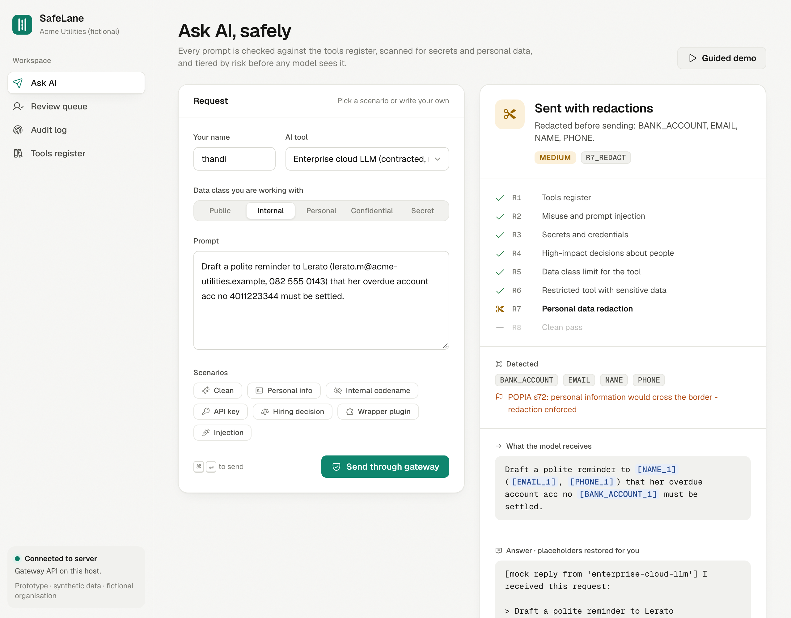
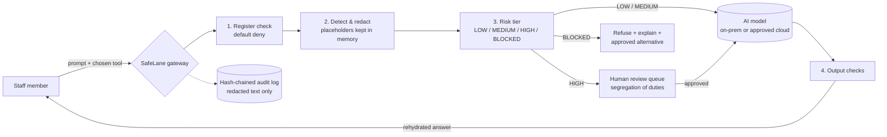

# SafeLane AI Gateway

**Make the safe way to use AI the easiest way.**

**▶ Live demo:** [sibusiso90.github.io/safelane](https://sibusiso90.github.io/safelane/). No install needed: it runs entirely in your browser, so nothing you type is sent anywhere.  
**🎬 Demo video:** [docs/SafeLane_Demo.mp4](docs/SafeLane_Demo.mp4) is a 5½-minute narrated walkthrough of every feature.

SafeLane sits between staff and AI tools. Each prompt passes through it on the way out, and it does four things:

1. **Checks the AI Tools Register.** Approved, restricted, not approved or prohibited. Anything unlisted is blocked by default, and the user is pointed to an approved alternative.
2. **Redacts sensitive data before it leaves.** Names, SA ID numbers, cards, bank accounts, phone numbers, e-mails, credentials and internal codenames are replaced with placeholders. The model never sees the real values; the gateway swaps them back into the answer for the user.
3. **Sorts each request by risk.** `LOW` → send. `MEDIUM` → send redacted. `HIGH` (e.g. *"should we hire her?"*) → hold for a human reviewer. `BLOCKED` (secrets, injection attempts, unapproved tools) → refuse and explain.
4. **Logs everything in a tamper-evident audit trail.** A SHA-256 hash chain means any edited or deleted entry is detected. The log stores the *redacted* prompt, so the audit trail does not become a new leak.

It also **checks what comes back**: sensitive data the user never sent, made-up placeholders, unverified links, and *"draft only, a person decides"* labels on high-impact answers.

> Built for the Credify System Thinking Challenge 2026, challenge area 01: *AI & Cybersecurity*.
> All data in this repository is synthetic. The organisation ("Acme Utilities") is fictional.



---

## Why a gateway and not just a policy?

Staff use AI because it saves them time. When the approved route is slower than a personal chatbot account, people take the shortcut, and a ban pushes that use out of sight (shadow AI). SafeLane works with that incentive instead of against it: the governed route is the quick one, and the controls run automatically. The full system analysis (stakeholders, root causes, causal loops, options considered, risks) is in [docs/SafeLane_Project_Documentation.pdf](docs/SafeLane_Project_Documentation.pdf).

## Technologies used

- **Python 3.10+** with **FastAPI** and **Uvicorn** for the gateway API
- **Pydantic** for request validation; **PyYAML** for the AI Tools Register
- **SQLite** (Python standard library) for the hash-chained audit log, using **SHA-256**
- **Plain HTML/CSS/JavaScript** single-page UI, with no build step
- **httpx** for calling an optional OpenAI-compatible model endpoint (e.g. a local **Ollama**)
- **pytest** for the automated tests
- **Pyodide** (Python compiled to WebAssembly) and **GitHub Pages / Actions** for the online demo

No cloud services, API keys or external databases are required to run it.

## Architecture



| Path | What it is |
|---|---|
| `safelane/redactor.py` | Detectors (regex + checksums + context rules), placeholder mapping, rehydration |
| `safelane/policy.py` | Register, risk rules R1–R8, output checks |
| `safelane/audit.py` | SQLite hash-chained audit log + verification |
| `safelane/llm.py` | Mock model (default) or any OpenAI-compatible endpoint, e.g. a local Ollama |
| `safelane/service.py` | Gateway logic (ask, review queue, audit), independent of any web framework |
| `safelane/main.py` | FastAPI app exposing the gateway over HTTP |
| `static/index.html` | Single-page demo UI (no build step) |
| `static/pyodide-api.js` | In-browser backend for the online demo: runs the same `safelane` package via Pyodide |
| `config/register.yaml` | Example AI Tools Register + sensitive internal terms |
| `eval/` | Synthetic test sets, evaluation script, results |
| `tests/` | 27 automated tests |

### Policy rules (evaluated in order; the first match wins)

| Rule | Trigger | Decision |
|---|---|---|
| R1 | Tool is unlisted, not approved, or prohibited | BLOCKED + suggest approved tool |
| R2 | Prompt-injection / control-evasion pattern | BLOCKED + security flag |
| R3 | Credential or key, going to an off-premises tool | BLOCKED + "rotate it" flag |
| R4 | Decision about a person or money (hire, dismiss, loan, claim…) | HIGH → human review |
| R5 | Declared data class above the tool's approved level | BLOCKED (approved tool) / HIGH (restricted tool) |
| R6 | Sensitive data on a restricted tool | HIGH |
| R7 | Sensitive data on an approved tool | MEDIUM → redact and send |
| R8 | Nothing sensitive | LOW → send |

## Run it

**Online:** https://sibusiso90.github.io/safelane/ is the same code, deployed to GitHub Pages by `.github/workflows/pages.yml`. With no server there, the page loads Python in the browser (Pyodide) and runs the gateway locally. Each visitor gets their own fresh audit log and review queue, which reset on reload.

**Locally:**

Requires Python 3.10+.

```bash
git clone https://github.com/sibusiso90/safelane.git && cd safelane
python -m venv .venv && source .venv/bin/activate      # Windows: .venv\Scripts\activate
pip install -r requirements.txt
uvicorn safelane.main:app --reload
```

Open http://localhost:8000 and use the sample buttons (Personal info, API key, Hiring decision, Wrapper plugin, Injection…). Approve a held request in **Review queue** under a *different* name, then click **Verify chain** under **Audit log**.

The quickest tour is **Guided demo** on the Ask AI page: nine steps, one click each, from redaction to a blocked self-approval to a caught tampering attempt. **Simulate tampering** under **Audit log** edits one stored entry without updating its hash, so you can watch verification fail and then restore it. The online demo always shows it (each visitor has their own in-browser log). Locally it is off by default, because it lets anyone who can reach the API edit the log; start the server with `SAFELANE_DEMO=1 uvicorn safelane.main:app` to show it.

**Use a real model (optional).** By default a mock model is used, so nothing leaves your machine and no API key is needed. To use a local model:
```bash
export SAFELANE_LLM_URL=http://localhost:11434/v1     # Ollama's OpenAI-compatible API
export SAFELANE_LLM_MODEL=qwen3:4b-instruct
```

**Tests and evaluation**
```bash
pytest -q                                   # 27 tests
python eval/run_eval.py eval/heldout_v3.jsonl  # also: heldout, prompts, adversarial
```

## Results (synthetic data; see `eval/README.md` for method and caveats)

| Test set | Version | Detection precision / recall | Decision accuracy | Sensitive values reaching an external model |
|---|---|---|---|---|
| Held-out 1 (20 prompts) | v1 | 80.0% / 40.0% | 45.0% | 5 of 10 |
| **Held-out 1** | **v2** | **88.9% / 80.0%** | **95.0%** | **1 of 10** |
| Held-out 2 (30 prompts, names + credentials) | v2 | 100% / 13.6% | 50.0% | 17 of 20 |
| **Held-out 2** | **v3** | **100% / 95.5%** | **96.7%** | **1 of 20** |
| Policy-only baseline | n/a | n/a | n/a | every value |

Each version was scored once on a test set written before it. v1 failed a hand-written adversarial set and was improved into v2, which was then scored on held-out set 1. Its one miss (a bare `admin / P@ssw0rd` pair) and the missing name detection were reported, not patched. For v3, held-out set 2 was written, committed and scored against v2 **before** any v3 code existed (commit `b4734cf`). v3 adds person names and unlabelled credential pairs, and was then scored on set 2 once. Its one miss is a lowercase name (`tell sibongile …`).

## Known limitations

- **Rule-based detection.** It's explainable and fast. It finds names from the words around them (titles, greetings, "tell …", "… from procurement"), so it misses a name written with no such cue or in lower case, and it also redacts company or famous names that look like people ("Grant Thornton from audit"). Next step: an on-prem NER model behind the same interface.
- **Small, self-written test sets.** Needs independent red-teaming and a consented sample of real prompts.
- **Users can't currently bypass the gateway from inside it, but they can open a browser.** The gateway only works if network controls (proxy/CASB rules) also block unapproved AI sites. That is a deployment dependency, not code.
- **Review queue is in memory** (by design, so real values never touch disk), so pending reviews are lost on restart. Production would use an encrypted store with expiry.
- **Demo identity is a free-text name.** Production would use SSO/Active Directory and role-based reviewer rights.
- **Output checks are heuristics.** They flag; they do not prove an answer is correct.

## Contribution and AI-assistance disclosure

- **Sibusiso Mahlangu (sole entrant):** problem framing and system analysis; the design pattern (a register with four statuses, default deny, closing the "wrapper app" loophole, on-prem first, risk-tiered human review), drawn from his own work on AI governance and an on-premises AI pilot at a South African state-owned entity; choice of intervention; review and acceptance of all code and results.
- **AI assistance:** an AI assistant (Claude, by Anthropic) was used under his direction to write much of the code, the synthetic test sets and first drafts of the documentation. Every result in this repository was produced by running the code included here.

## Licence

MIT
